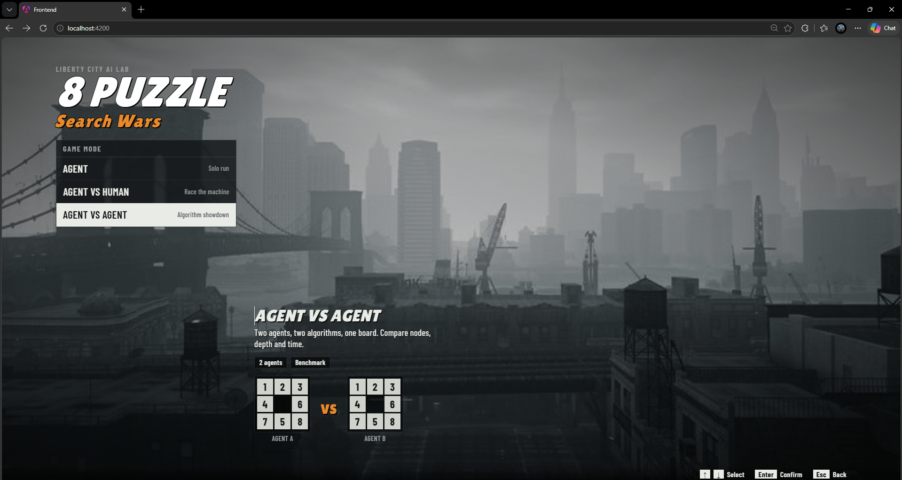
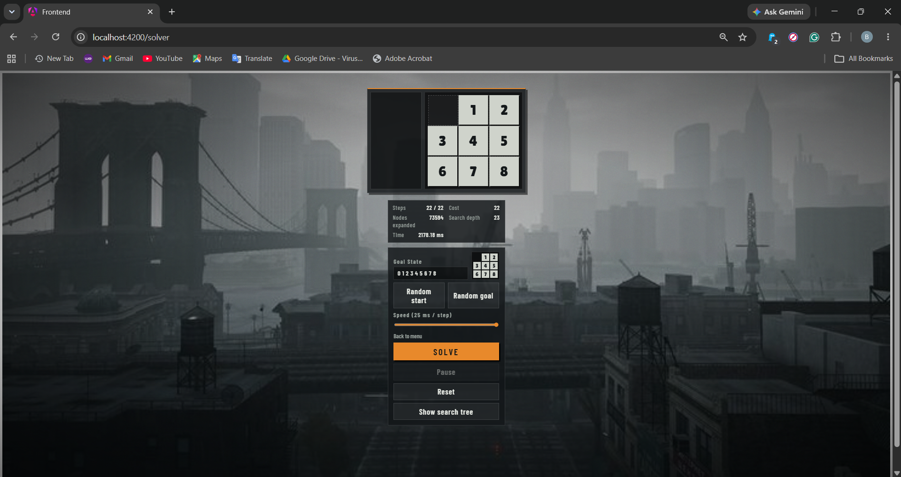
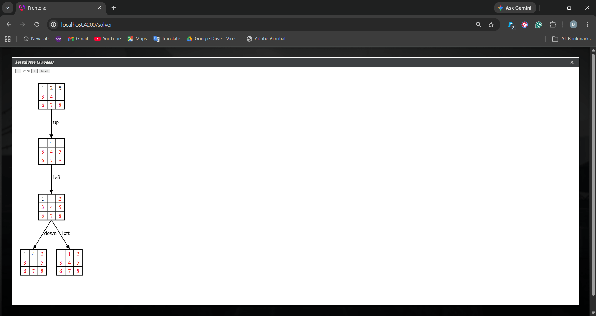
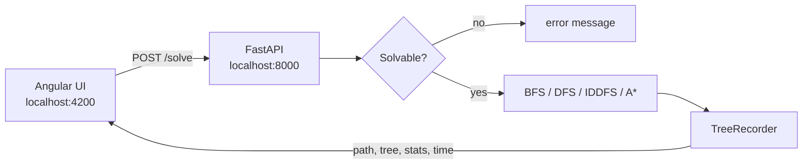
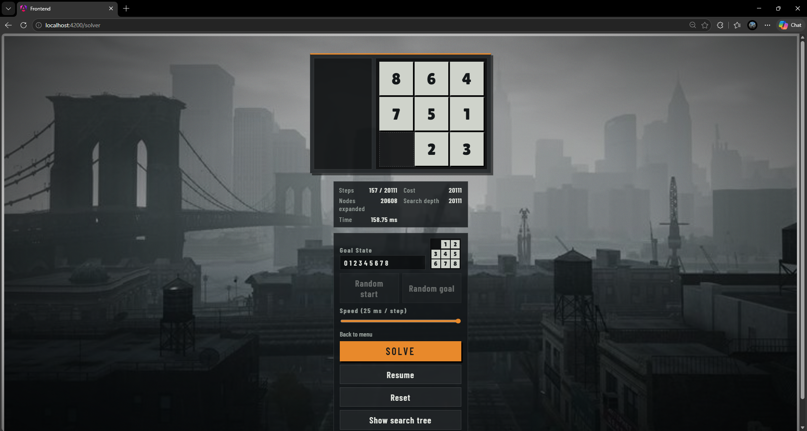
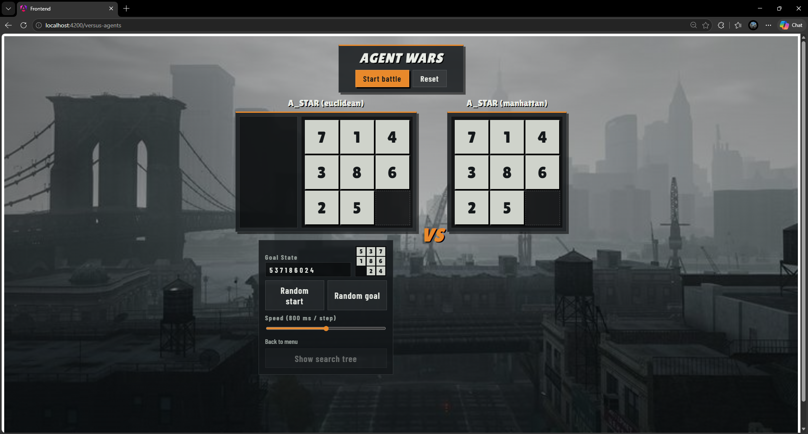
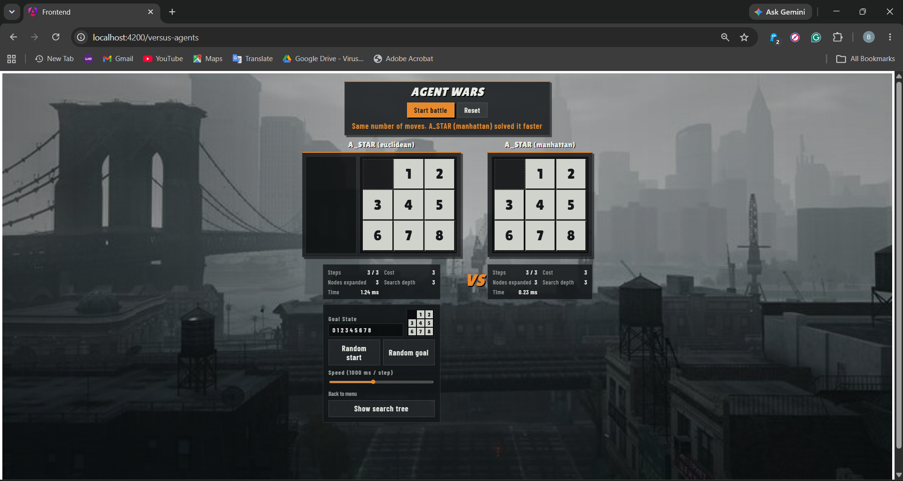
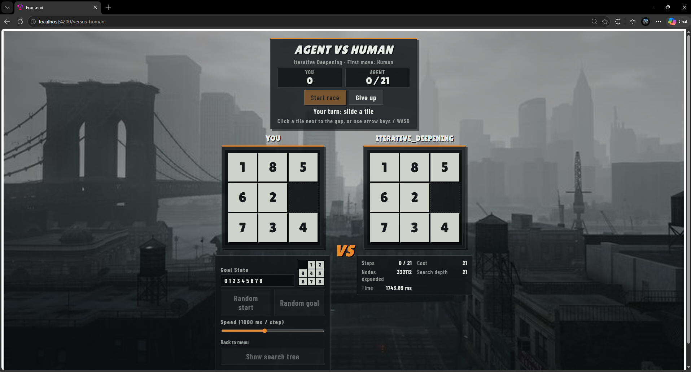

# 8 Puzzle: Search Wars

Solve the 8-puzzle with **informed and uninformed search algorithms**, watch the agent move tile by tile, inspect the search tree it built, and race it against a human or against another algorithm.

> Assignment 1, Artificial Intelligence, Alexandria University, Faculty of Engineering (Computer and Systems Program).




---

## Demo video

<p align="center">
  <a href="https://youtu.be/yRMOeO5ikAc">
    
  </a>
</p>

<p align="center">
  <a href="https://youtu.be/yRMOeO5ikAc">
    
  </a>
  <br>
  <sub>Click the image or the button to open the demo on YouTube</sub>
</p>


---

## Table of contents

- [Features](#features)
- [Algorithms](#algorithms)
- [Project structure](#project-structure)
- [Getting started](#getting-started)
- [Using the app](#using-the-app)
- [REST API](#rest-api)
- [Results and comparison](#results-and-comparison)
- [Implementation notes](#implementation-notes)

---

## Features

- **5 solvers:** BFS, DFS, Iterative Deepening DFS, A\* with Manhattan distance, A\* with Euclidean distance.
- **3 game modes:** single agent, Agent vs Human, Agent vs Agent.
- **Custom boards:** place tiles by hand, type any goal state, or generate a random start or goal.
- **Solvability check** before every run (inversion parity), so unsolvable boards are rejected with a clear message.
- **Animated solution** with adjustable speed, pause, resume and reset.
- **Live stats:** path cost, nodes expanded, search depth and running time.
- **Search tree viewer:** zoomable tree of mini boards with the move on every edge. A tile already in its goal position is drawn in red.

| Single agent | Search tree |
|---|---|
|  |  |

---

## Algorithms

| Algorithm | Frontier | Explored set | Complete | Optimal | Time | Space |
|---|---|---|:---:|:---:|---|---|
| BFS | Queue (FIFO) | Hash set | Yes | Yes | O(b^d) | O(b^d) |
| DFS | Stack (LIFO) | Hash set | No | No | O(b^m) | O(bm) |
| Iterative Deepening DFS | Recursive stack | Hash set | Yes | Yes | O(b^d) | O(bd) |
| A\* (Manhattan) | Min-heap | Hash map (`cost_so_far`) | Yes | Yes | depends on h | O(b^d) |
| A\* (Euclidean) | Min-heap | Hash map (`cost_so_far`) | Yes | Yes | depends on h | O(b^d) |

Every move costs 1, so path cost equals the number of moves. The default goal state is:

```
0 1 2
3 4 5      (0 = blank)
6 7 8
```

**A\*** orders the heap by `f(n) = g(n) + h(n)` and breaks ties by smaller `g(n)`. If a state is reached again with a cheaper cost, its cost is updated.

$$h_{Manhattan}(n)=\sum_{t=1}^{8}\left(|x_t-x_t^{goal}|+|y_t-y_t^{goal}|\right)\qquad h_{Euclidean}(n)=\sum_{t=1}^{8}\sqrt{(x_t-x_t^{goal})^2+(y_t-y_t^{goal})^2}$$

The blank tile is excluded from both sums.

---

## Project structure

```
8_puzzle_game/
├── api.py                  # FastAPI app: POST /solve
├── bfs.py                  # Breadth-first search
├── dfs.py                  # Depth-first search
├── iterative_deepening.py  # Iterative deepening DFS
├── AStar.py                # A* search
├── heuristics.py           # Manhattan and Euclidean heuristics
├── helpers.py              # Child generation (blank moves up/down/left/right)
├── solvability.py          # Inversion-parity solvability test
├── TreeRecorder.py         # Records the search tree, stats and solution path
├── requirements.txt
├── frontend/               # Angular app
│   ├── package.json
│   └── src/app/
│       ├── components/
│       │   ├── menu/           # Mode and algorithm selection
│       │   ├── board/          # Board, controls, animation, stats
│       │   ├── search-tree/    # d3-hierarchy tree viewer
│       │   ├── versus-human/   # Agent vs Human
│       │   └── agent-battle/   # Agent vs Agent
│       ├── services/           # solveService (HTTP), gameConfigService
│       └── models/
└── docs/
    └── images/             # Screenshots used in this README
```



---

## Getting started

### Prerequisites

| Tool | Version |
|---|---|
| Python | 3.10 or newer |
| Node.js | 20.19 or newer (needed by Angular 20) |
| npm | comes with Node.js |

### 1. Clone

```bash
git clone https://github.com/Bavly-Hany2385/8_puzzle_game.git
cd 8_puzzle_game
```

### 2. Backend (FastAPI), port 8000

```bash
# optional but recommended: virtual environment
python -m venv .venv
source .venv/bin/activate          # Windows: .venv\Scripts\activate

pip install -r requirements.txt

python -m uvicorn api:app --reload
```

Run this from the **project root** (the folder that contains `api.py`), because the modules import each other directly.

| URL | What it is |
|---|---|
| http://localhost:8000 | API root |
| http://localhost:8000/docs | Interactive Swagger UI, try `/solve` from the browser |
| http://localhost:8000/redoc | ReDoc documentation |

### 3. Frontend (Angular), port 4200

Open a **second terminal**:

```bash
cd frontend
npm install
npx ng serve        # or: npm start
```

If you have the Angular CLI installed globally (`npm i -g @angular/cli`), plain `ng serve` works too.

Open **http://localhost:4200** and you should see the main menu.

> The frontend calls `http://localhost:8000` and the backend only allows requests from `http://localhost:4200` (CORS). If you change a port, update `apiUrl` in `frontend/src/app/services/solveService.ts` and `allow_origins` in `api.py`.

---

## Using the app

### Main menu

Choose a mode, then pick the algorithm for each agent and press **START**.

| Key | Action |
|---|---|
| ↑ ↓ or W S | Move selection |
| ← → or A D | Change the highlighted option |
| Enter or Space | Confirm |
| Esc or Backspace | Back |

### Agent (solo run)

Build a start state by clicking a tile in the left sidebar and then a cell on the board (or press **Random start**), edit the goal state if you want, and press **Solve**. You get the animated solution, the stats panel, the list of moves, and a **Show search tree** button.



### Agent vs Agent

Two algorithms get the same board. Both solve first, then both animate together. The winner is the one with **fewer moves**, and if the move counts are equal, the **faster** one.



A\* with Manhattan against A\* with Euclidean on the same board:



### Agent vs Human

You slide tiles by clicking a tile next to the gap, or with the arrow keys or WASD, while the agent follows its solution. Choose who moves first: **Human**, **Agent**, or **Simultaneous**. The first to reach the goal wins, and **Give up** ends the race.



---

## REST API

### `POST /solve`

Request:

```json
{
  "start_node": [1, 2, 5, 3, 4, 0, 6, 7, 8],
  "goal_node":  [0, 1, 2, 3, 4, 5, 6, 7, 8],
  "algorithm":  "a_star",
  "heuristic":  "manhattan"
}
```

| Field | Values |
|---|---|
| `start_node`, `goal_node` | 9 integers, row by row, `0` is the blank |
| `algorithm` | `bfs`, `dfs`, `iterative_deepening`, `a_star` |
| `heuristic` | `manhattan` (default) or `euclidean`, used by `a_star` only |

Response:

```json
{
  "path": [[1,2,5,3,4,0,6,7,8], [1,2,0,3,4,5,6,7,8], "..."],
  "tree": [{ "id": 0, "state": [1,2,5,3,4,0,6,7,8], "parent": null, "move": null }, "..."],
  "time": 0.23,
  "stats": { "cost": 3, "nodes_expanded": 3, "search_depth": 3 }
}
```

- `time` is in milliseconds.
- `tree` is trimmed to the first 400 nodes **plus** every node on the solution path, so large searches stay light for the browser.
- If the board cannot reach the goal, the response is `{"error": "Unsolvable puzzle configuration.", "path": null, ...}`.

Quick test:

```bash
curl -X POST http://localhost:8000/solve \
  -H "Content-Type: application/json" \
  -d '{"start_node":[1,2,5,3,4,0,6,7,8],"goal_node":[0,1,2,3,4,5,6,7,8],"algorithm":"bfs"}'
```

---

## Results and comparison

Goal state in all runs: `0 1 2 3 4 5 6 7 8`. Times depend on the machine.

### Run 1: easy instance, start `1 2 5 3 4 0 6 7 8`

| Algorithm | Path cost | Nodes expanded | Search depth | Time (ms) |
|---|---:|---:|---:|---:|
| BFS | 3 | 10 | 4 | 2.45 |
| DFS | 31 | 31 | 31 | 0.72 |
| Iterative DFS | 3 | 8 | 3 | 2.78 |
| A\* (Manhattan) | 3 | 3 | 3 | **0.23** |
| A\* (Euclidean) | 3 | 3 | 3 | 1.24 |

### Run 2: start `6 2 0 8 7 3 4 5 1`

| Algorithm | Path cost | Nodes expanded | Search depth | Time (s) |
|---|---:|---:|---:|---:|
| BFS | 22 | 73,594 | 23 | 6.125 |
| DFS | 27,236 | 27,928 | 27,236 | 0.725 |
| Iterative DFS | 22 | 502,054 | 22 | 12.363 |
| A\* (Manhattan) | 22 | **601** | 22 | **0.457** |
| A\* (Euclidean) | 22 | 896 | 22 | 0.555 |

### Run 3: hard instance, start `1 0 3 4 5 2 7 6 8`

| Algorithm | Path cost | Nodes expanded | Search depth | Time (s) |
|---|---:|---:|---:|---:|
| BFS | 21 | 59,256 | 22 | 0.400 |
| DFS | 20,111 | 20,608 | 20,111 | 0.159 |
| Iterative DFS | 21 | 342,958 | 21 | 1.863 |
| A\* (Manhattan) | 21 | 1,449 | 21 | 0.027 |
| A\* (Euclidean) | 21 | 1,702 | 21 | 0.024 |

### What the numbers say

- **Optimality:** BFS, Iterative DFS and both A\* variants always return the shortest path. DFS finds *a* path, but it can be thousands of moves long (20,111 in Run 3 against an optimal 21).
- **Memory vs speed:** DFS is fast and light but gives up optimality. BFS is optimal but keeps a huge frontier.
- **Iterative DFS** is optimal with a small memory footprint, but it re-expands the upper levels at every depth limit, so it expands the most nodes (502,054 in Run 2). The `nodes_expanded` it reports is the total across all iterations.
- **A\*** is the clear winner: it expands 1 to 2 orders of magnitude fewer nodes than BFS while staying optimal.
- **Manhattan vs Euclidean:** both are admissible, but Manhattan is always greater than or equal to Euclidean for the same board, so it is the more informed heuristic. Since tiles only move horizontally and vertically, it expands fewer nodes (601 vs 896 in Run 2, 1,449 vs 1,702 in Run 3).

---

## Implementation notes

- **State:** a tuple of 9 integers (row-major, `0` = blank).
- **Moves:** generated by moving the blank in the order Up, Down, Left, Right.
- **Solvability:** count inversions (ignoring the blank) in the start and goal states. For a 3×3 board the puzzle is solvable if and only if both counts have the same parity.
- **TreeRecorder:** gives every generated node an id in order of creation, stores its parent, move and depth, and rebuilds the solution path by walking parents back to the root.
- **Metrics:**
  - *Nodes expanded:* number of states whose children were generated.
  - *Search depth:* deepest node recorded in the tree.
  - *Time:* measured with `time.perf_counter()` around the solver call.
- **Iterative deepening** runs with `max_depth=100`.

---


